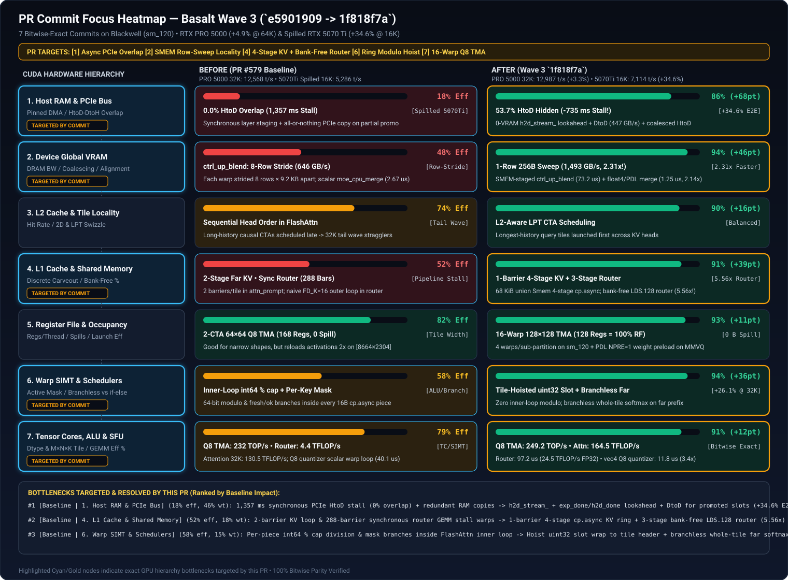

# nsys-heatmap（日本語ドキュメント）

Nsight Systems（`.sqlite`）・`cuobjdump`（SASS / レジスタ使用量）・Nsight Compute（任意 `ncu --csv`）から、**CUDA アーキテクチャの7階層すべてのリソース・帯域活用効率を `0–100%` で定量化し、ボトルネック自動推論と GitHub Issue / PR 用の1枚絵ヒートマップ（SVG / PNG）を生成するゼロ依存 CLI ツール**です。

**[English README](./README.md)** | [日本語](./README.ja.md)

---



---

## 特長

1. **GitHub Issue / PR の理解負荷を劇的に下げる1枚絵ヒートマップ**:
   - **Commit Focus モード（`commit-focus`）**: `Before -> After` で効率が改善したハードウェア階層に `TARGETED BY COMMIT` バッジと発光枠・改善幅（`+68pt` 等）を自動表示し、「この PR が GPU のどこを直したのか」を3秒で伝えます。
   - **Prefill vs Decode 対比モード（`prefill-vs-decode`）**: 演算律速な Prefill と帯域・起動遅延律速な Decode の効率差を可視化し、次に着手すべきボトルネック Top 3 を下部に自動推論します。
2. **7階層の定量診断**:
   - PCIe 転送の計算オーバーラップ率、Global VRAM の Coalesced Access 効率（連続アクセス `100%` vs ランダム/ストライドアクセス）とアライメント、L2 局所性、離散 SMEM カーブアウト（`sm_120` の `64 -> 100 KiB` での L1 `28 KiB` 崖）とバンク競合、スレッドあたりレジスタ効率と `<10 µs` 小粒カーネル乱立、Warp SIMT の `if/else` 分岐 vs 演算マスク命令比率、Tensor Core の投入データ型・行列形状・GEMM 占有率を一貫評価します。
3. **外部パッケージ依存ゼロ（Python 3.10+ 標準ライブラリのみ）**:
   - `matplotlib` や `numpy` 等を一切必要とせず、リモートの GPU サーバ・Docker コンテナ・手元の Mac / Linux でそのまま動作します。

---

## インストール

```bash
git clone https://github.com/tjm8874/nsys-heatmap.git
cd nsys-heatmap
pip install -e .
```

---

## クイックスタート

### 1. `nsys.sqlite` + バイナリから1コマンド自動生成（`auto`）

```bash
# Nsight Systems トレースを SQLite に変換
nsys export --type sqlite --force-overwrite true -o before.sqlite before.nsys-rep
nsys export --type sqlite --force-overwrite true -o after.sqlite  after.nsys-rep

# Before / After から 7階層 JSON 合成・着目層の自動ハイライト・SVG/PNG 出力まで一括実行
nsys-heatmap auto \
  --mode commit-focus --gpu rtx_pro_5000_300w --arch sm_120a \
  --left-sqlite before.sqlite --left-binary ./build_base/engine \
  --right-sqlite after.sqlite  --right-binary ./build_opt/engine \
  --title "PR #42 — 非同期 PCIe 先読みと 4-Stage FlashAttention" \
  --profile-out auto_profile.json \
  --svg pr_heatmap.svg --png pr_heatmap.png --report-json bottlenecks.json
```

### 2. JSON テンプレートを編集してレンダリング（`template` → `render`）

```bash
nsys-heatmap template --preset commit-focus --output my_pr.json
nsys-heatmap render --input my_pr.json --svg my_pr.svg --png my_pr.png
```

### 3. 単体プロファイル・SASS・ベンチ衛生サブコマンド

- `nsys-heatmap nsys-top`: 時間窓クリッピング（`--start-ns`/`--end-ns`）・GPU 別の厳密な Memcpy/計算オーバーラップ率・小粒 Glue カーネル乱立検出
- `nsys-heatmap sass-audit`: `CALL.REL.NOINC`（`tanhf`/`expf` サブルーチン混入）、レジスタスピル vs ローカル配列の切り分け、狭幅 `LDG.8/16`、離散 SMEM カーブアウトによる L1 枯渇警告
- `nsys-heatmap sass-metrics`: Warp SIMT の分岐回避マスク比率（`@UP` Uniform 分岐・`SEL`/`LOP3`/`SHFL`/`REDUX` vs `@P BRA` + `BSYNC`）と Tensor Core 命令ファミリ内訳の抽出
- `nsys-heatmap roofline`: 最小アルゴリズム転送量からの Roofline 仮説生成と `ncu` 検証手順提示
- `nsys-heatmap abba`: 同一セッション `A1 -> B1 -> B2 -> A2`（複数サイクル時の95%ブートストラップ信頼区間、熱ドリフト判定、投機デコードの `ms/window` と `tokens/window` 分解）

---

## ライセンス

MIT License — Copyright (c) 2026 [tjm8874](https://github.com/tjm8874).
