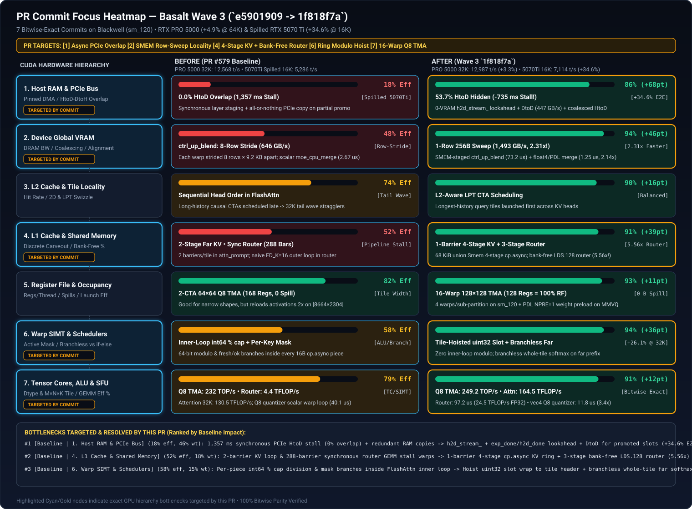
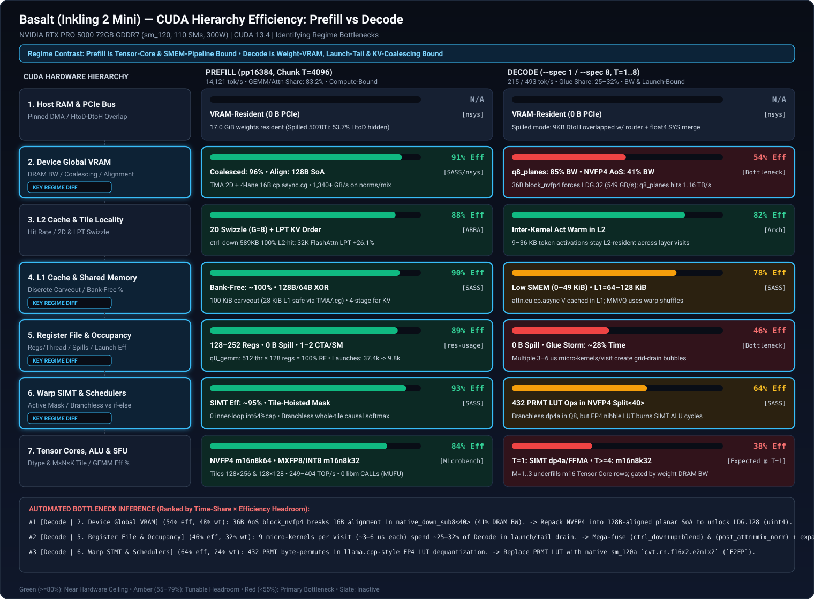

# nsys-heatmap

**Zero-dependency 7-layer CUDA hardware efficiency analyzer, bottleneck inference engine, and GitHub PR heatmap generator** built on Nsight Systems (`.sqlite`), `cuobjdump` SASS disassembly, and optional Nsight Compute (`ncu --csv`) telemetry.

[English](./README.md) | **[日本語ドキュメント](./README.ja.md)**

---



---

## Why `nsys-heatmap`?

CUDA optimization spans seven tightly coupled hardware layers — from **Host RAM / PCIe DMA** down through **Global VRAM Coalescing & Alignment**, **L2 Locality**, **Discrete SMEM/L1 Carveouts & Bank Conflicts**, **Register File & Launch Tail Efficiency**, **Warp SIMT Branchless Masks**, and **Tensor Core Data Types & Tiles**.

Raw profiler tables (`nsys stats`, `cuobjdump -sass`, `ncu`) bury reviewers in thousands of numbers. **`nsys-heatmap`** turns them into:

1. **One GitHub Issue / PR Image (`SVG` + `PNG`)**: Spotlights the exact GPU hardware layers targeted by a commit (`TARGETED BY COMMIT`, `Before -> After (+Δpt)`) or contrasts **Prefill vs Decode** regimes side-by-side.
2. **Automated Bottleneck Ranking**: Scores each tier (`0–100%` efficiency), separates healthy hardware ceiling saturation (`>= 80%`) from low-efficiency stalls, and ranks the top actionable bottlenecks by `Phase Time Share × Efficiency Headroom`.
3. **Zero Third-Party Dependencies**: Pure Python `>= 3.10` standard library (`sqlite3`, `csv`, `json`). Runs out-of-the-box on bare-metal GPU nodes, containers, CI runners, and macOS/Linux laptops without `matplotlib`, `numpy`, or `cairo` wheels.

### Regime Comparison Mode (`prefill-vs-decode`)



---

## Installation

```bash
# Clone & install in editable mode (zero external dependencies)
git clone https://github.com/tjm8874/nsys-heatmap.git
cd nsys-heatmap
pip install -e .

# Or run directly without installation:
PYTHONPATH=src python3 -m nsys_heatmap --help
```

---

## Quick Start

### 1. One-Shot `auto` Pipeline (Directly from `nsys` SQLite + Binary)

Export Nsight Systems traces to `.sqlite` (`nsys export --type sqlite trace.nsys-rep`) and generate a complete **Before vs After** PR heatmap in one command:

```bash
nsys-heatmap auto \
  --mode commit-focus --gpu rtx_pro_5000_300w --arch sm_120a \
  --left-sqlite before.sqlite --left-binary ./build_base/engine \
  --right-sqlite after.sqlite  --right-binary ./build_opt/engine \
  --title "PR #42 — Async PCIe Overlap & 4-Stage FlashAttention" \
  --profile-out auto_profile.json \
  --svg pr_heatmap.svg \
  --png pr_heatmap.png \
  --report-json bottlenecks.json
```

Compare **Prefill vs Decode** regimes on the same binary (or add optional `--left-ncu-csv` / `--right-ncu-csv` from `ncu --csv` for hardware counter precision):

```bash
nsys-heatmap auto \
  --mode prefill-vs-decode --gpu rtx_pro_5000_300w --arch sm_120a \
  --left-sqlite prefill_16k.sqlite \
  --right-sqlite decode_step.sqlite \
  --binary ./build/engine \
  --svg regime_heatmap.svg --png regime_heatmap.png
```

### 2. Custom / Annotated PR Heatmaps (`template` → `render`)

Want fine-grained custom callouts for a PR description? Dump a JSON template, edit any headline/detail, and render:

```bash
nsys-heatmap template --preset commit-focus --output my_pr.json
nsys-heatmap render --input my_pr.json --focus host_pcie,smem_l1,warp_simt --svg my_pr.svg --png my_pr.png
```

*(PNG conversion automatically uses `rsvg-convert`, `resvg`, macOS `sips`, or `inkscape` when available; `.svg` embeds directly on GitHub Issues and PRs everywhere.)*

---

## Diagnostic Subcommands

Beyond visual heatmaps, `nsys-heatmap` ships standalone CLI analyzers for daily kernel engineering across **Ampere (`sm_80`)**, **Ada (`sm_89`)**, **Hopper (`sm_90a`)**, and **Blackwell (`sm_100a` / `sm_120a`)**:

| Subcommand | Purpose |
| :--- | :--- |
| `nsys-heatmap auto` | End-to-end `nsys.sqlite` + SASS/binary (+ optional `ncu --csv`) -> 7-layer JSON + SVG/PNG |
| `nsys-heatmap render` | Render SVG/PNG + bottleneck queue from a 7-layer JSON profile or preset |
| `nsys-heatmap nsys-top` | Window-clipped (`--start-ns`/`--end-ns`), **per-GPU isolated** kernel & `HtoD`/`DtoH` overlap summary + `<10 µs` glue launch storm detector |
| `nsys-heatmap sass-audit` | `cuobjdump -sass/-res-usage` audit: detects `CALL.REL.NOINC` (`libm` traps), `STL`/`LDL` spills vs local arrays, narrow `8/16-bit` loads, `PRMT` LUT storms, and **discrete SMEM carveout cliffs** (`64 -> 100 KiB` -> `28 KiB` L1 on `sm_89`/`sm_120`) |
| `nsys-heatmap sass-metrics` | Quantifies Warp SIMT branchless mask ratio (`@P`/`SEL`/`LOP3`/`SHFL`/`REDUX` vs divergent `@P BRA` + `BSYNC`), load-width coalescing score, and Tensor Core opcode families (`NVFP4 OMMA`, `MXFP8 QMMA`, `INT8 IMMA`, `WGMMA`, `tcgen05`) |
| `nsys-heatmap roofline` | Computes algorithmic GB/s, TFLOP/s, arithmetic intensity, and candidate bottleneck hypotheses + `ncu` counter verification steps |
| `nsys-heatmap abba` | Validates `1..N` interleaved `A1 -> B1 -> B2 -> A2` benchmark cycles with **95% bootstrap CI**, thermal drift checks, and Speculative Decoding `ms/window` vs `tokens/window` decomposition |

---

## The 7-Layer Efficiency Model

| Layer | Key Signals Evaluated |
| :--- | :--- |
| **1. Host RAM & PCIe Bus** | Per-GPU `HtoD`/`DtoH` compute overlap `%`, exposed PCIe stall `ms`, achieved link GB/s (detects unpinned pageable host memory) |
| **2. Device Global VRAM** | Physical DRAM `%` (`ncu`) & sector coalescing efficiency (`4 sectors / req` = `100%` contiguous vs strided/random gather), SASS load width (`UTMALDG`/`LDG.128` vs `LDG.8/16`), `16B`/`128B` SoA alignment |
| **3. L2 Cache & Locality** | `lts__t_sector_hit_rate.pct` (`ncu`) or CTA grid wave quantization across target GPU SMs |
| **4. L1 & Shared Memory** | Hardware discrete SMEM carveout (`0/8/16/32/64/100 KiB` + `1 KiB`/CTA reserved on `sm_120`), remaining L1 cliff (`28 KiB` without TMA/`.cg`), SMEM bank-conflict-free `%` |
| **5. Registers & Occupancy** | Warp-granular register file utilization (`ceil(regs/8)*8`), confirmed `SPILL_STORES`, active warp occupancy, and `<10 µs` micro-kernel grid-drain overhead |
| **6. Warp SIMT & Schedulers** | Active thread mask (`thread_inst_executed / 32`), uniform `@UP` branches vs divergent `@P BRA` + `BSYNC`, branchless predicate/mask instructions, un-inlined `CALL` count |
| **7. Tensor Cores, ALU & SFU** | Decoded Tensor Core dtype & shape (`m16n8k64` NVFP4, `m16n8k32` MXFP8/FP8/INT8, `WGMMA`, `tcgen05`, `dp4a`), GEMM/Attention time share `%`, expected low-batch GEMV exclusion |

---

## Running Tests

```bash
python3 -m unittest discover -s tests -v
```

## License

MIT License — Copyright (c) 2026 [tjm8874](https://github.com/tjm8874).
